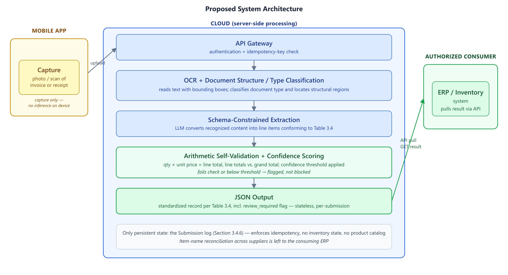
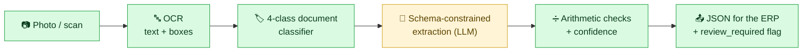
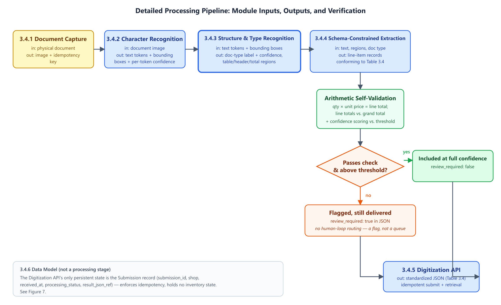
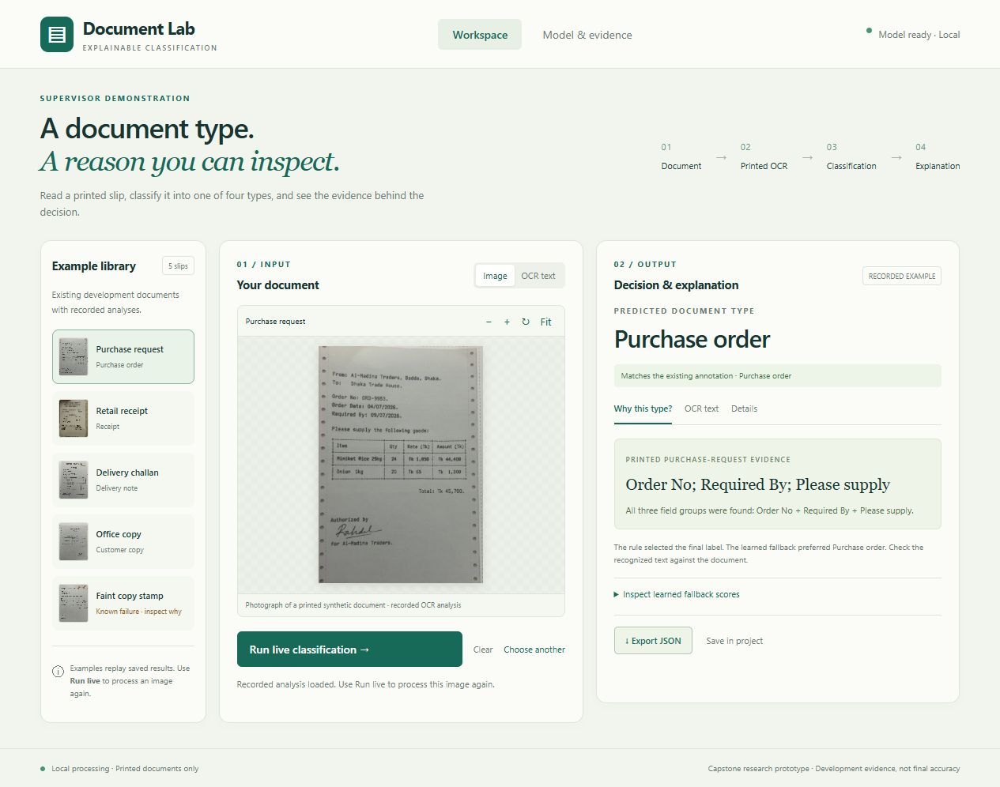
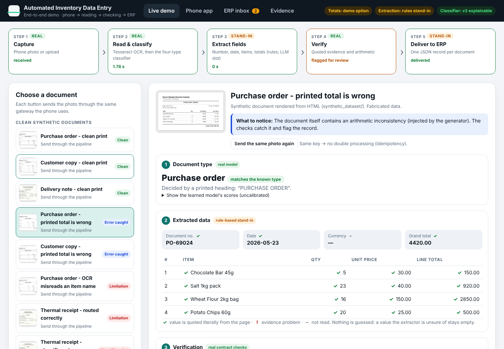

<div align="center">

# 🧾 Automated Inventory Data Entry

### through Intelligent Character and Document Structure Recognition

**Turn photographed paper documents into structured, checkable data for inventory and ERP systems.**


[**The report**](#-source-of-truth) ·
[**How it works**](#-how-it-works) ·
[**Status**](#-where-the-project-stands) ·
[**Demo**](#-see-it-run) ·
[**Run it**](#-run-it) ·
[**Layout**](#-repository-layout)

<br>



<sub>Proposed architecture from the signed report (Figure 2).</sub>

</div>

---

## 📌 The problem

Small shops and fulfilment centres still receive purchase orders, receipts and delivery notes on paper, in a different layout from every supplier. Someone has to read each one and key it into the inventory system by hand. That is slow and error-prone, so it often doesn't get done consistently.

This project designs a **document-digitisation gateway** to take over that step. Photograph a document, and the gateway reads it, works out what kind of document it is, extracts the line items into a fixed JSON schema, and checks that the numbers add up. Anything it can't verify is flagged instead of silently trusted.

<p align="center">
<b>Supervisor:</b> Md. Mijanur Rahman &nbsp;·&nbsp; <b>Institution:</b> BUBT, Dept. of CSE
</p>

---

## 📖 Source of truth

> [!IMPORTANT]
> **The signed Chapters 1–3 report is the authoritative statement of the project's scope, design and evaluation plan.**
> Everything in [`deliverables/`](deliverables/) is stored **byte-for-byte unmodified**. Do not edit, re-export or "tidy" those files. If the report changes, add a new, clearly named file beside it.

| 📄 File | What it is |
|---|---|
| [`deliverables/Signed/Capstone_Report_Ch1_3.pdf`](deliverables/Signed/Capstone_Report_Ch1_3.pdf) | **Signed report, as handed to the supervisor** |
| [`deliverables/Report/Capstone_Report_Ch1_3.pdf`](deliverables/Report/Capstone_Report_Ch1_3.pdf) | Unsigned PDF of the same report |
| [`deliverables/Report/Capstone_Report_Ch1_3.docx`](deliverables/Report/Capstone_Report_Ch1_3.docx) | Word source |
| [`deliverables/Signed/Proposal.pdf`](deliverables/Signed/Proposal.pdf) | Signed project proposal |
| [`deliverables/Capstone_Presentation.pptx`](deliverables/Capstone_Presentation.pptx) | Presentation slides |

[`.gitattributes`](.gitattributes) switches off line-ending conversion, so a checkout on any platform returns exactly the committed bytes. The editable drafts in [`docs/design/`](docs/design/) are working material, **not** the submitted report.

---

## ⚙️ How it works



<p align="center">
<sub>🟩 built and measured &nbsp;·&nbsp; 🟨 built as a manual handoff (an AI sub-agent does the extraction; no unattended LLM backend yet)</sub>
</p>

| Stage | What it does |
|:---:|---|
| **1 · OCR** | Reads the text and word boxes from the photo (Tesseract, run locally). |
| **2 · Classify** | Picks one of four document types and shows the rules and n-grams behind each decision. |
| **3 · Extract** | Turns the text into line items under a fixed JSON schema. The prompt is exported, and the model's JSON answer is imported. |
| **4 · Verify** | Checks `quantity × unit price = line total` and `Σ lines = document total`. Anything unverifiable sets `review_required`. |
| **5 · Submit** | Keeps one record per document under a unique key. Replaying a key returns the same result, and reusing it with different content is a conflict (idempotent). |

> [!NOTE]
> Passing the arithmetic checks is **not proof** a value is correct. Consistently wrong numbers can still add up.

### The four document classes

| | Class | Typical content |
|:---:|---|---|
| 📝 | `purchase_order` | A buyer asking a supplier for goods |
| 🧾 | `receipt` | Proof of a completed sale or payment |
| 🚚 | `delivery_note` | Goods handed over, usually quantities only |
| 📋 | `customer_copy` | The customer's retained copy of a slip |

<details>
<summary><b>Detailed pipeline from the report (Figure 4)</b></summary>
<br>
<p align="center"></p>
</details>

---

## 🚦 Where the project stands

The report designs a mobile-to-cloud gateway for printed *and* handwritten documents. What exists today is narrower. Each narrowing is recorded as a decision in [`Context/`](Context/).

| Area | Report (design) | As built so far | |
|---|---|---|:---:|
| Documents | Printed + handwritten | English **printed** only (decided 2026-10-20) | 🟡 |
| Classes | PO, receipt, delivery note, customer copy | The same four | ✅ |
| OCR | Cloud OCR | Local Tesseract | ✅ |
| Classifier | Document structure / type recognition | Explainable hybrid, with a demo app | ✅ |
| Extraction | Cloud LLM, unattended | Manual hand-off to an AI sub-agent | 🟡 |
| Verification | Arithmetic + confidence | Decimal arithmetic checks, `review_required` flag | ✅ |
| API | Stateless, idempotent | Local gateway with idempotent submissions | ✅ |
| Capture | Mobile app | Local web upload | 🟡 |
| Deployment | Cloud | Runs locally only | ⬜ |
| Independent evaluation | Real-document test set | None yet (holdout manifest is empty) | ⬜ |

✅ working &nbsp; 🟡 narrowed or partial &nbsp; ⬜ not done

### Measured results (and their limits)

<table>
<tr>
<td align="center" width="25%"><h2>23 / 25</h2><b>92 %</b><br>classifier on the<br>development validation set</td>
<td align="center" width="25%"><h2>146 / 150</h2><b>97.3 %</b><br>grouped training<br>cross-check</td>
<td align="center" width="25%"><h2>49</h2><b>checks passing</b><br>downstream pipeline<br>(software tests)</td>
<td align="center" width="25%"><h2>0</h2><b>independent</b><br>real-document<br>test documents</td>
</tr>
</table>

- The classifier is `printed_v3_explainable`, a hybrid of corrected OCR, versioned printed-document rules and TF-IDF + ComplementNB. **Neither accuracy figure is independent final accuracy**, because the rules and model were tuned against those sets.
- The 49 pipeline checks are *software* checks. They are not extraction accuracy, and **no extraction accuracy is claimed**.
- Still missing: an independent real-document test set, an unattended LLM backend, a mobile app, cloud deployment and human-verified field truth.

[`Context/STATUS.md`](Context/STATUS.md) is the dated, detailed log. If it disagrees with this page, it wins. Synthetic or hand-built examples are never presented as measured results.

---

## 🖥️ See it run

<div align="center">


<sub><b>Document Lab</b>, the local classifier demo. Pick an example or upload a slip, and it shows the predicted type and the evidence behind it.</sub>

<br><br>


<sub><b>End-to-end demo</b> (<a href="full_demo/README.md">full_demo/</a>): a phone PWA sends a photo through OCR, classification, extraction and verification into an ERP inbox. Here the printed total is wrong, and the checks flag it. Walkthrough: <a href="full_demo/DEMO_SCRIPT.md">DEMO_SCRIPT.md</a>.</sub>
</div>

---

## 🚀 Run it

The launchers are for **Windows** (`.cmd` / PowerShell). The Python itself is portable. You need Python 3.12–3.14 and Tesseract OCR. HEIC photos also need `pillow-heif`.

**1 · One-time setup**

```powershell
./classifier/setup.ps1
```

This creates a virtual environment and writes `classifier/engine/runtime.local.json`. That file is machine-specific, so it is not committed. Dependencies are in `classifier/requirements-demo.txt`, with pinned versions in `classifier/engine/requirements-lock.txt`.

**2 · Launch an app**

| App | Launcher | Opens at |
|---|---|---|
| 🌐 **End-to-end demo**: phone PWA → OCR → classify → extract → verify → ERP | `full_demo/Open Demo.cmd` (or `Open Demo (phone).cmd`; `./full_demo/run.sh` elsewhere) | <http://127.0.0.1:8790> |
| 🔬 **Document Lab**, the classifier demo | `classifier/Open Demo.cmd` | <http://127.0.0.1:8770> |
| 🎓 **Supervisor showcase** | `supervisor_showcase/Open Showcase.cmd` | <http://127.0.0.1:8780> |
| 🔁 **Document pipeline**, the gateway | `services/document_pipeline/Open Pipeline.cmd` | <http://127.0.0.1:8772> |
| ✏️ **Annotation portal** | `services/annotation_portal/Open Portal.cmd` | <http://127.0.0.1:8765> |

Add `-RegionOcr` to `services/document_pipeline/start.ps1` to turn on automatic table-cell OCR.

**3 · Tests** sit beside the code: `classifier/tests/`, `classifier/engine/test_*.py`, `services/document_pipeline/test_*.py`, `services/annotation_portal/test_portal.py` and `supervisor_showcase/tests/`. Some historical engine tests need PyTorch, which the demo does not require.

Component guides: [end-to-end demo](full_demo/README.md) · [classifier](classifier/README.md) · [document pipeline](services/document_pipeline/README.md) · [annotation portal](services/annotation_portal/README.md) · [supervisor showcase](supervisor_showcase/README.md)

---

## 🗂️ Repository layout

```text
.
├── 📦 deliverables/          Submitted work, UNMODIFIED (report, proposal, slides, signed copies)
├── 📚 docs/                  Design drafts, research logs, collection guides, LARGE_FILES.md
├── 🔬 research/              Literature by topic + public-dataset assessment
├── 🖼️ figures/               Diagram sources (SVG) and PNG exports
├── 🗃️ Dataset/               Curated corpus, annotations, intake batches, holdout area
├── 🧪 synthetic_dataset/     120 fabricated documents + ground truth + generators
├── 🌉 ChatGPT_Bridge/        Prompts, images, review history for the synthetic set
├── 🏷️ classifier/            Four-class classifier: engine, demo app, tests
├── 🔧 services/
│   ├── document_pipeline/      OCR → classify → extract → verify → submit
│   ├── annotation_portal/      Transcription review app
│   └── document_classifier/    Legacy location; keeps old paths resolving
├── 🌐 full_demo/             End-to-end demo: phone PWA, dashboard, ERP stand-in, script
├── 🎓 supervisor_showcase/   Supervisor-meeting app + saved decisions
└── 🧠 Context/               Shared project memory: status, decisions, handoffs
```

Rules for where new files go are in [`Context/ORGANIZATION.md`](Context/ORGANIZATION.md). Paths inside the notes, manifests and launchers follow this layout, so check references before moving anything.

---

## 🗄️ Data

| Source | Where | Notes |
|---|---|---|
| Curated corpus (140 images used) | `Dataset/{Purchase_Order, Receipt, Delivery_Note, Customer_Copy}` | Fixed split 86 / 26 / 28. Rejected samples stay in `_excluded/`. |
| Phone photos of printed synthetic documents | `Dataset/Dataset-2/` | 54 HEIC: 21 PO, 24 delivery notes, 9 customer copies. Synthetic, not real transactions. |
| Reference transcriptions | `Dataset/annotations/` | AI-assisted drafts, `human_verified=false` throughout. Versioned editions and scope definitions. |
| Reviewed external intake | `Dataset/intake/2026-10-19/` | 91 accepted additions (ExpressExpense SRD, Company Documents v2). Not merged into training. |
| External candidates | `Dataset/external_candidates/` | Provenance for every evaluated source. Samples with unresolved redistribution rights are not published here. |
| Synthetic documents | `synthetic_dataset/` | 120 fabricated examples, 30 per class. |

Do not regenerate datasets or bridge prompts just to inspect them, because the generators can overwrite files. Source licences and attributions are in [`research/datasets/sources.csv`](research/datasets/sources.csv) and in the notices stored beside each source.

### 📦 Large files

Files of 10 MB or more are not stored in git (the signed report is the exception). That covers some experiment checkpoints, a few reference papers, the Tesseract language data and the meeting recording. [`docs/LARGE_FILES.md`](docs/LARGE_FILES.md) lists each one with its path and a link to the shared Google Drive folder.

---

## 🤝 Working on the project

1. Read [`Context/README.md`](Context/README.md) → [`PROJECT.md`](Context/PROJECT.md) → [`STATUS.md`](Context/STATUS.md) → [`DECISIONS.md`](Context/DECISIONS.md).
2. After meaningful work, add a dated entry to `STATUS.md`. Record scope or design decisions in `DECISIONS.md`.
3. Keep raw datasets, ground truth, review history, signed documents and older deliverables intact. Keep synthetic and real evaluation data separate.
4. Write commit messages in [Conventional Commits](https://www.conventionalcommits.org/) style: `feat:`, `fix:`, `docs:`, `data:`, `chore:`.

<sub>Third-party datasets and papers keep their own licences and copyrights; the notices are stored beside the data.</sub>
