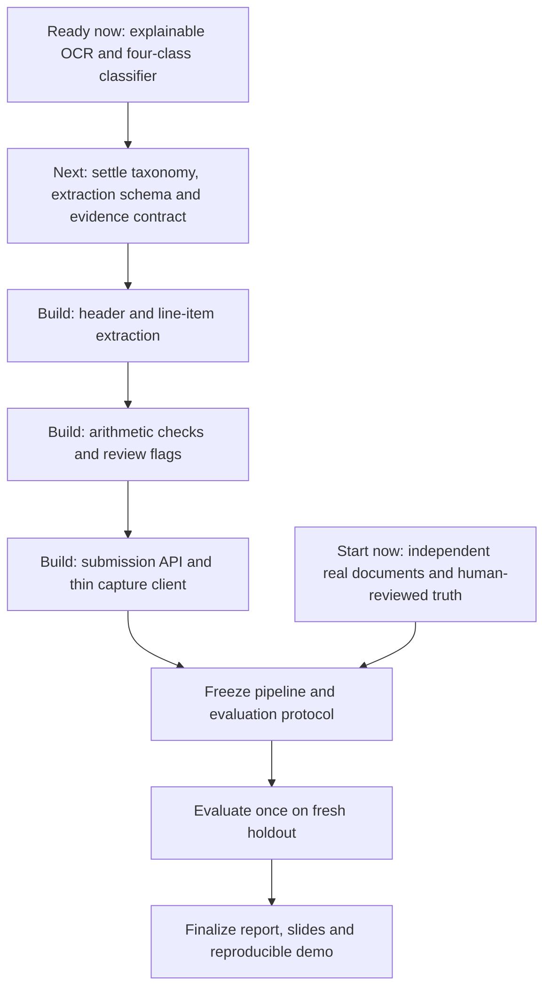

# Capstone readiness and recommended roadmap — 2026-10-20

Assessment requested by the user after classifier stabilization. This is a planning assessment based on saved project files, not a new experiment, deployment test or approved expansion of scope. No overall completion percentage or delivery dates are assigned because remaining implementation effort and the submission deadline are not established.

## Where we stand

The project has a demonstrable, explainable classification subsystem. The document-to-structured-record gateway described in the report remains incomplete.

Verified from selected-run JSON and current documentation:
- Selected classifier: classifier/engine/runs/printed_v3_explainable; corrected local Tesseract OCR, printed-text rules and trained TF-IDF/ComplementNB fallback.
- Adaptive development validation: 23/25, accuracy 92%, macro-F1 0.9211. The standalone learned classifier was 15/25; do not attribute the hybrid result to BERT or the learned model alone.
- Validation recall: purchase_order 10/10, receipt 3/3, delivery_note 3/3, customer_copy 7/9. All three validation delivery notes are photographed synthetic documents; only eight training customer copies.
- Grouped training OOF plus adaptive rule overlay: 146/150. This is development evidence, not independent final accuracy.
- Document Lab supports upload/live OCR and classification, recorded development examples, actual decision evidence, OCR inspection and classification-report JSON export. The JSON export is not extracted line-item/business-record JSON.
- Saved demo QA records 43 passing automated checks and a browser walkthrough. These were inspected, not rerun during this assessment. Setup on a second PC has not been tested.
- Fresh real holdout manifest contains a header and no acquired-document rows.
- No downstream extraction, arithmetic verification, ERP gateway or mobile application is established in the shared implementation record; the inspected services contain classifier compatibility and annotation-portal code.

## Dependency graph

The graph indicates dependencies and proposed order, not elapsed time or measured project completion. Documentation and data collection should run alongside implementation. Development data must remain separate from the untouched final holdout.

## Recommended work packages and completion gates

1. **Align the contract and report.** Keep English printed/typeset/thermal scope and exactly four classifier outputs. Resolve copy-marked PO/delivery precedence and unpaid-bill/hybrid admission rules before new labels. Copy status overlaps transaction type, so the single-label rule must be explicit. Revise the provisional schema to distinguish uncalibrated scores, actual rule evidence and any future calibrated confidence. Permit absent/unreadable values without guessing. Define class-appropriate optional fields, null semantics, currency, discounts/tax and validation status. Choose a bounded extraction pilot and document local versus cloud processing. Gate: versioned schema, taxonomy and evidence/flag definitions with reviewed fixtures.
2. **Build one vertical extraction slice.** Image -> existing OCR/classifier -> schema-constrained header and line-item extraction -> validated JSON. Begin with one document class, then extend through all four. Preserve source text/regions for extracted fields where available; do not claim bounding-box evidence until implemented. Do not force an absent price or grand total onto delivery notes. Benchmark candidate extraction configurations on separate development documents before selecting one. Gate: actual live input yields parseable business-record JSON, including explicit missing fields and an ambiguous/failed example.
3. **Add verification.** Check quantity x unit price, line totals and document totals with explicit decimal/rounding tolerance and tax/discount handling. Missing operands produce not_applicable, not passed. Preserve extracted values and record issues rather than silently repairing them. Use deterministic review reasons initially; do not rename them calibrated confidence. Consistent but incorrect values can pass arithmetic. Gate: meaningful fixtures for correct, inconsistent, unreadable, missing and arithmetically consistent-but-wrong records; output distinguishes checks from proof of correctness.
4. **Expose the gateway and capture flow.** Implement submission and result endpoints, a persistent Submission record, idempotency and predictable failures. The same key/payload should reuse the result; a reused key with changed payload should be rejected. Demonstrate a labelled ERP-consumer stub without adding stock management. Implement minimal authorized-consumer access and basic document retention rules appropriate to the selected deployment. Keep capture thin; a phone-friendly client is a candidate, while whether the course requires a native mobile app remains unconfirmed. If cloud deployment remains a report claim, demonstrate it or explicitly revise the architecture claim. Gate: capture -> result -> consumer walkthrough, including retry, conflicting payload, bad input and processing failure.
5. **Establish independent evidence.** Start collection immediately using docs/data-collection/FRESH_HOLDOUT.md: existing planning target 80 real printed documents, 20/class, at least five independent business/layout families/class. This is a target, not acquired data or an accuracy guarantee. Separately collect development additions, especially customer-copy families and real delivery notes. Human-review class labels and extraction truth without seeing predictions. Freeze taxonomy, model/rules/OCR, extraction configuration, verification thresholds and manifest before the final run. Never tune on this holdout; if results drive changes, use another untouched set for a new final claim. Gate: provenance, permissions, overlap audit, reviewed truth and frozen hashes.
6. **Evaluate and package.** Report classification accuracy/macro-F1/confusion matrix; OCR CER/WER with numeric-field results where reviewed references support them; header/numeric field accuracy and line-item matching; schema validity; wrong unflagged fields/records with explicit denominators; flag rate and catch rate; median/p95 latency and cost if paid services are used. Compare extraction without verification against the identical outputs with verification, and compare classifier rules-only, learned-only and hybrid under a frozen protocol. Also show all-document accuracy alongside flagged/unflagged coverage. Avoid claiming a review-all policy is useful because its silent-error rate is zero. Report uncertainty, real/synthetic coverage and failure cases. Controlled fault injection is diagnostic evidence and must be reported separately from naturally occurring measured extraction errors. Gate: reproducible results and a clean installation/demo rehearsal, including another PC if portability is claimed.

## Presentation standard

A strong final demonstration should show a clean document, a verification-flagged document, an honest failure and a duplicate submission. Follow each from image to OCR, class/evidence, extracted fields/line items, checks, JSON and the consumer response. Label replay versus live inference and real versus synthetic examples.

The research story is: can a scoped explainable recognition/extraction gateway reduce manual entry while detecting some otherwise silent errors? The reduction is a hypothesis until measured. Preserve rejected architectures as evidence of engineering tradeoffs, rather than adding complexity for appearance.

Update editable report/slides and diagrams to reflect printed-only scope, the actual hybrid, local OCR, and classification-only responsibilities. Remove unsupported novelty claims only after checking sources; verify citations before the final report. Keep signed documents and older deliverables unchanged. Prepare a concise pitch, architecture diagram, provenance/split diagram, independent results, verification comparison, limitations, install guide and backup recording.

## What to avoid

- Further tuning against the same 25 validation examples to advertise a larger headline accuracy.
- Presenting 92% as independent real-world accuracy, 97.3% as a final test result, or 43 workflow checks as recognition accuracy.
- Handwriting, multilingual expansion, owned inventory/catalog/stock/valuation, or an internal approval queue without a separate scope decision.
- Unneeded native-app polish, new classifier architectures or mandatory table-detection machinery before proving the extraction slice. Table localization may be added downstream if extraction measurements justify it.
- Invented missing values, uncalibrated scores labelled confidence, arithmetic pass labelled semantic correctness, or explanations labelled proof.
- Mixing generated originals, photographed copies, related business templates or final holdout material into development in ways that leak evaluation.
- Treating synthetic records, replay examples, AI-reviewed references or injected faults as independently human-verified real-world measurements.

## Sources inspected

Context/README.md, PROJECT.md, STATUS.md, ORGANIZATION.md and DECISIONS.md; classifier/README.md; classifier/engine/EXPLAINABLE_CLASSIFIER.md; selected-run validation.json and final_validation.json; classifier/docs/demo-validation.json; docs/design/inventory_data_entry_report_ch1_2_3_draft.md (especially Tables 3.3/3.4 and Chapter 4 evaluation plan); docs/data-collection/FRESH_HOLDOUT.md; Dataset/holdout_real_pending/manifest.csv. Historical service paths in older sources map to classifier/engine as documented.
