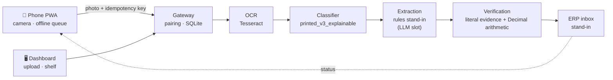

# End-to-end demo

One app that shows the **whole system** working, not just the classifier:



| | |
|---|---|
| **Live demo** | Send a prepared document (or your own photo) through the real pipeline and watch each stage, with the evidence behind every decision. |
| **Phone app** | An installable PWA: camera capture, downscaling, offline queue with idempotent retry, plain-language results. Shown in a phone frame on the dashboard, or on a real phone. |
| **ERP inbox** | A stand-in for the customer's ERP. Receives one JSON record per document; flagged records arrive *blocked for review*. |
| **Evidence** | What is real and what is a stand-in, the saved classifier results, a fresh measurement on 86 synthetic documents, known gaps, next steps. |

For the presentation itself read **[DEMO_SCRIPT.md](DEMO_SCRIPT.md)**.

## Run it

**Windows.** Set up once with `classifier\Setup Demo.cmd` (see the main README), then double-click:

* `Open Demo.cmd`: dashboard at <http://127.0.0.1:8790>
* `Open Demo (phone).cmd`: the same, plus access for a phone on the same Wi-Fi (allow Python on *private* networks if Windows Firewall asks)

**Linux / macOS.** `./full_demo/run.sh` (add `--lan` for phone access). It installs the Python packages if missing and copies Tesseract's English data to the place the classifier expects.

Useful options: `--policy strict|demo_reconcile`, `--port N`, `--pin 123456`, `--extractor-cmd "<command>"`.

Before a presentation press **Reset demo data** on the ERP tab for an empty inbox.

### Using a real phone

1. Start with `Open Demo (phone).cmd` (or `--lan`). The *Phone app* tab shows a QR code and a 6-digit pairing code.
2. Scan the QR with the phone camera. The code is filled in automatically. Pairing happens once per phone.
3. Take a photo of any printed document. It appears in the dashboard live.

Plain `http://` over Wi-Fi works for capture, but browsers only allow **installing** the PWA (and its offline cache) on `https` or `localhost`. For an installable demo, put an https address in front of the port, for example `cloudflared tunnel --url http://localhost:8790`, and open that address on the phone. The pairing code still protects it.

## What is real and what is a stand-in

| Stage | In this demo |
|---|---|
| Phone capture | **Real PWA.** Tested in an emulated phone browser (pairing, camera input, offline queue, reconnect, offline reopen). **Not yet tested on a physical phone.** |
| OCR | **Real.** Tesseract 5. |
| Document type | **Real.** The project's selected `printed_v3_explainable` model, unchanged. |
| Field extraction | **Stand-in.** `extractor.py` is a deterministic rule-based reader that quotes the OCR text and refuses to guess ambiguous rows. The design calls for a schema-constrained LLM here; none is provisioned, and **no LLM accuracy is claimed anywhere**. Plug one in with `--extractor-cmd` (the command receives the project's real extraction prompt on stdin and prints one JSON object; its output goes through the same verification). |
| Verification | **Real.** The project's unchanged `services/document_pipeline/contract.py`: exact OCR quotes for every value, Decimal arithmetic. See the policy note below. |
| Gateway | **Real, local.** `services/document_pipeline/gateway.Store`: persisted, idempotent submissions. Same key + same photo replays; same key + different photo is a 409 conflict. |
| ERP | **Stand-in.** An inbox. `inventory_updated` is always `false`. |
| Cloud hosting, accounts, human review queue | **Not built.** |

### The verification policy choice

The project contract proves a grand total only when subtotal, tax and discount are all printed. The synthetic documents print only a grand total, so under the **strict** contract 84 of 86 get flagged. That is safe but makes a poor demo and a poor product if most real documents look like this.

The demo therefore starts on **`demo_reconcile`**, an option added in `verify.py`, **not part of the contract**: when only a grand total is printed it compares it with the sum of the line totals, *assuming there is no tax or discount*, and it flags documents missing a number, date or total. The header badge always shows which policy is active, and any result can switch to strict in one click. Which policy to adopt is a decision for the supervisor.

## Measured on 86 synthetic documents

`python full_demo/evaluate_synthetic.py` (cached OCR, a few seconds; `--live-ocr` re-runs OCR and the classifier, about 3 minutes). Results are in `data/evaluation.json`.

Scope: the 86 printed/thermal documents of `synthetic_dataset/` (handwritten ones are out of the project's scope). `classifier/engine/prepare.py` excludes these images from the classifier's training corpus. They are clean synthetic renders, so **these are not real-world accuracy figures**. OCR was Tesseract 5.3.4 with its standard English data, which may differ from the project's own earlier OCR data.

| Measurement | Result |
|---|---|
| Routed to the right type | **65 / 86** (76%). Printed-heading rules: 56 / 56. Learned model (all 30 receipts): **9 / 30**. |
| Documents read with every field exact | **27 / 86**. Most of the rest are OCR slips such as `1L` → `iL`, `5kg` → `S5kg`, or numbers missing from cropped images. |
| Documents with a printed arithmetic error | **17 / 17 flagged**, including under `demo_reconcile` where clean documents can pass. (Under strict this is a weaker statement, because strict flags nearly everything.) |
| Strict contract | 84 / 86 flagged. 2 wrong records unflagged. |
| `demo_reconcile` | 47 / 86 flagged. 18 correct and passed, 41 wrong and caught, **21 wrong and not flagged**. |

The 21 unflagged wrong records are the project's central risk made visible: mostly item-name OCR slips that arithmetic cannot see. Receipts are the classifier's weak spot: the printed-heading rules have no rule for the bare word "RECEIPT". The recorded 23 / 25 development validation (shown on the Evidence tab) came from a tuned set, so it is a development number, not final accuracy.

## Layout

```
full_demo/
├── server.py            HTTP server: pairing, async capture, ERP inbox, settings, simulate, reset
├── extractor.py         rules stand-in + external-command extractor
├── verify.py            project contract + the opt-in demo policy
├── evaluate_synthetic.py  reproducible measurement on the synthetic dataset
├── build_shelf.py       copies the curated demo documents into shelf/ (+ ground truth)
├── shelf/               13 demo documents and shelf.json (what to notice for each)
├── data/                evaluation.json, cached OCR for the evaluation
├── web/                 dashboard (index.html, app.js, style.css) and shared reasons.js
├── web/m/               the PWA (manifest, service worker, app.js, icons)
├── tests/test_demo.py   31 tests
├── docs/screenshots/    pictures from the browser run
├── start.ps1, *.cmd, run.sh, requirements.txt
└── .runtime/            demo database and uploaded photos (git-ignored)
```

## Safety and data handling

* Phones need a 6-digit pairing code (5 wrong tries lock pairing for a minute). The dashboard session is only issued to a direct request on this computer, and is refused for anything arriving through a proxy or tunnel.
* Uploaded photos are kept in `.runtime/uploads/` so the dashboard can show them, and are removed by **Reset demo data**. They never enter training or annotation data.
* Extracted values are always marked as not human-verified. Nothing changes stock.
* This is a local demo server, not a production deployment.

## Tests

```bash
python -m unittest discover -s full_demo/tests -v
```

31 tests: extractor, both verification policies, pairing and its rate limit, idempotency and conflicts, policy switching, error simulation, reset, static-file safety, an external-command extractor, and one with the real classifier. The project's existing `services/document_pipeline` suite (49 checks) still passes and the demo changes none of that code.
